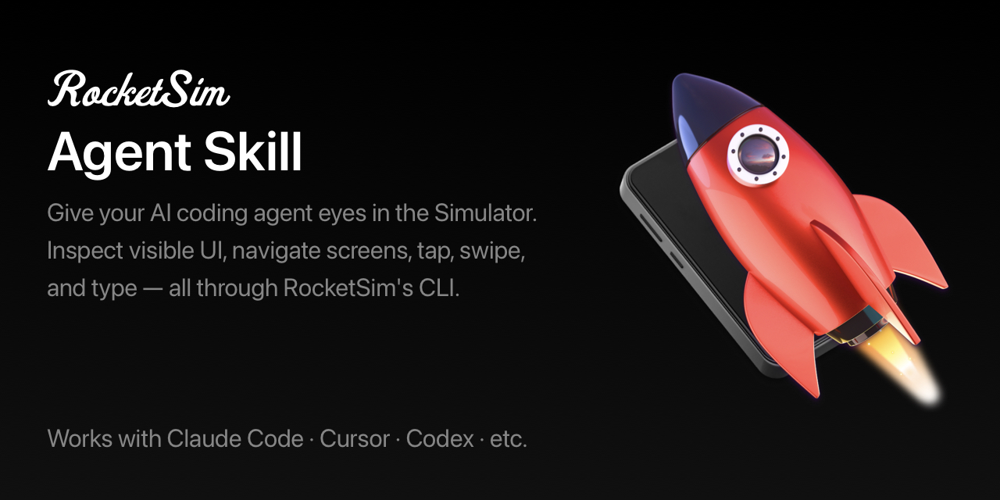

# RocketSim Agent Skill

The RocketSim Agent Skill teaches AI coding tools to drive iOS Simulator apps
through the [RocketSim](https://www.rocketsim.app) CLI: a stateful, low-token
agent protocol for inspecting visible UI and interacting with elements by
stable id.

For the canonical long-form `rs/1` protocol reference, see the
[RocketSim documentation](https://www.rocketsim.app/docs/features/agentic-development/).

## What It Does

- Reads visible accessibility elements as a compact agent snapshot with
  ephemeral ids and a stable screen hash.
- Lets agents tap, long-press, type, swipe, scroll, focus, and press hardware
  buttons by element id, with race protection via `--screen <hash>`.
- Exposes blocking primitives (`wait screen-changed`, `wait element`,
  `wait keyboard`) so the agent loop never busy-polls.
- Batches sequential steps with `do`, re-snapshotting between each step.

## Why Install It

Install this skill if you want your AI coding tool to use RocketSim as its
Simulator interaction layer instead of relying on ad-hoc automation.

This is especially useful if you want an agent to:

- Navigate repetitive Simulator flows faster with fewer retries.
- Read visible UI state before interacting with the app.
- Spend fewer tokens by using RocketSim's compact `--agent` snapshots.
- Stay in lock-step with the installed RocketSim version automatically.

## How It Works

The skill assumes `rocketsim` is on `PATH` and talks to the running RocketSim
app directly via the `rs/1` JSON protocol. There is no app-bundle discovery,
no version-matched bundled `SKILL.md` fetch, and no per-project skill copy
that can drift.

You expose the CLI on `PATH` once, via the RocketSim app:

> RocketSim → Settings → Command Line Tool → *Install Command Line Tool*

That symlinks `RocketSim.app/Contents/Helpers/rocketsim` into a `PATH`
directory of your choice (defaulting to `/opt/homebrew/bin` on Apple Silicon
or `/usr/local/bin` on Intel). Because the entry point is a **symlink**, the
CLI on `PATH` always equals the installed app version — App Store updates
keep both in lock-step with zero bookkeeping.

## How to Use This Skill

1. Install [RocketSim from the Mac App Store](https://apps.apple.com/app/apple-store/id1504940162?pt=117264678&ct=Agent-Skill-Readme&mt=8).
2. Open **RocketSim → Settings → Command Line Tool** and click *Install Command Line Tool*. Verify with `which rocketsim`.
3. Install this skill using one of the options below.
4. Open your agent and write a prompt similar to the example below.

Example prompt:

> Use RocketSim to navigate through `<your_app_name>` in the Simulator

### Option A: Using skills.sh

Install this skill with a single command:

```bash
npx skills add https://github.com/AvdLee/RocketSim-Agent-Skill --skill rocketsim
```

### Option B: Claude Code Plugin

To install this skill for your personal use in Claude Code:

1. Add the marketplace:

```bash
/plugin marketplace add AvdLee/RocketSim-Agent-Skill
```

2. Install the skill:

```bash
/plugin install rocketsim@rocketsim-agent-skill
```

### Option C: Cursor

This repository includes Cursor plugin metadata. Install or symlink the
`Agent-Skill/` folder into your Cursor skills directory following Cursor's
documentation:

```bash
mkdir -p .cursor/skills
ln -s /path/to/RocketSim-Agent-Skill/Agent-Skill .cursor/skills/rocketsim
```

### Option D: Codex / OpenAI-compatible tools

This repository includes an `agents/openai.yaml` manifest. Copy or symlink
the `Agent-Skill/` folder into your Codex skills directory:

```bash
cp -R Agent-Skill/ "$CODEX_HOME/skills/rocketsim"
```

See the [Codex skills documentation](https://developers.openai.com/codex/skills/) for details on where to save skills.

All packaged install surfaces in this repository point at this same repository
and the `Agent-Skill/` directory, so keep those paths aligned if you fork or
repackage the skill.

## How to Verify

Open an agent and ask it to:

> Use RocketSim to navigate through `<app_name>` in the Simulator

If `rocketsim` is on `PATH` and RocketSim is running, the agent should pick
up the skill, call `rocketsim screen` and `rocketsim elements --agent`, and
start interacting with the app based on what is on screen.

## Upgrading from 1.x

Versions before 2.0 used a discovery flow that walked the filesystem for the
RocketSim app bundle and read a version-matched `SKILL.md` from inside it.
Starting with 2.0 the skill talks to the CLI directly via the `rs/1`
protocol and assumes `rocketsim` is on `PATH`.

If you are upgrading:

1. Open **RocketSim → Settings → Command Line Tool** and click
   *Install Command Line Tool* once.
2. Reinstall the skill via one of the options above to pick up 2.0.

There is no per-project state to migrate.

## See Also My Other Skills

- [SwiftUI Expert](https://github.com/AvdLee/SwiftUI-Agent-Skill)
- [Core Data Expert](https://github.com/AvdLee/Core-Data-Agent-Skill)
- [Swift Testing Expert](https://github.com/AvdLee/Swift-Testing-Agent-Skill)
- [Swift Concurrency Expert](https://github.com/AvdLee/Swift-Concurrency-Agent-Skill)
- [Xcode Build Optimization](https://github.com/AvdLee/Xcode-Build-Optimization-Agent-Skill)

## Learn More

- [RocketSim website](https://www.rocketsim.app)
- [RocketSim documentation](https://www.rocketsim.app/docs)
- [Agentic development docs (rs/1 protocol reference)](https://www.rocketsim.app/docs/features/agentic-development/)
- [RocketSim on the Mac App Store](https://apps.apple.com/app/apple-store/id1504940162?pt=117264678&ct=Agent-Skill-Readme&mt=8)

## Support and Feedback

- Open a GitHub issue in this repository for skill-specific bugs or
  installation issues.
- Use the RocketSim documentation site for product guides and feature help.

RocketSim is developed by [Antoine van der Lee](https://www.avanderlee.com) and built by SwiftLee.
